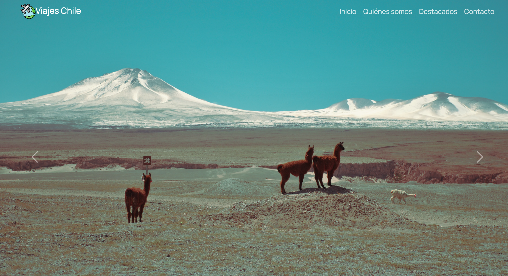

# Viajes Chile

Sitio web estático de una agencia de viajes que promueve destinos turísticos de Chile. Está desarrollado con HTML, CSS, JavaScript y Bootstrap 5, y se adapta a computadores, tablets y celulares.

🔗 **Ver en línea:** https://TU-USUARIO.github.io/NOMBRE-DEL-REPO/

<!-- Agrega aquí una captura de pantalla del sitio:
 -->

## Secciones del sitio

- **Inicio:** carrusel con tres imágenes de paisajes de Chile.
- **¿Quiénes somos?:** presentación de la agencia en tres columnas (se muestra desde pantallas medianas hacia arriba).
- **Destacados:** cuatro tarjetas con destinos: Torres del Paine, Lagunas Altiplánicas, Salar de Atacama y Carretera Austral.
- **Contacto:** formulario con nombre, asunto y mensaje.

## Características

- Diseño responsivo con la grilla de Bootstrap.
- Barra de navegación fija, con menú colapsable en celulares.
- Carrusel de imágenes con controles para avanzar y retroceder.
- Desplazamiento suave al navegar entre secciones (jQuery).
- Tooltips en el botón de envío y en los enlaces a redes sociales.
- Íconos de Font Awesome y tipografía Manrope de Google Fonts.

## Tecnologías

- HTML5
- CSS3
- JavaScript y jQuery 3.7.1
- Bootstrap 5.3.8
- Font Awesome 7
- Google Fonts (Manrope)

## Estructura del proyecto

```
.
├── index.html
└── assets
    ├── css
    │   └── style.css
    ├── img
    │   ├── viajes.svg
    │   ├── carousel1.jpg, carousel2.jpg, carousel3.jpg
    │   └── card1.jpg, card2.jpg, card3.jpg, card4.jpg
    └── js
        └── script.js
```

## Cómo verlo en tu computador

1. Descarga el repositorio (botón **Code**, luego **Download ZIP**) o clónalo:
   ```bash
   git clone https://github.com/TU-USUARIO/NOMBRE-DEL-REPO.git
   ```
2. Abre el archivo `index.html` en tu navegador.

El sitio carga Bootstrap, jQuery, Font Awesome y las fuentes desde internet, por lo que necesitas conexión para verlo completo.

## Nota

El formulario de contacto es demostrativo: no envía mensajes, porque el sitio es estático y no tiene servidor.

## Autor

Pablo Olivero
